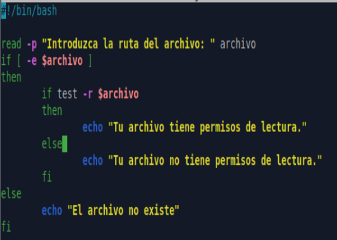
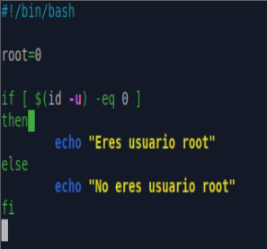
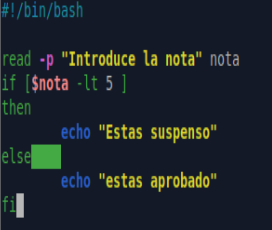
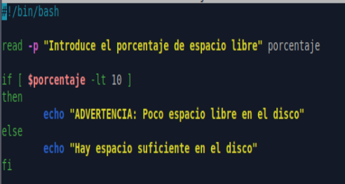
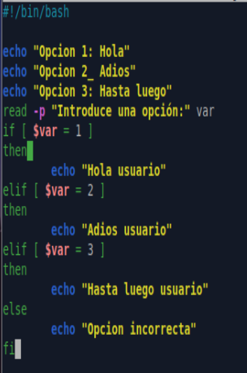
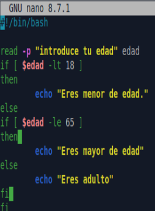

Ejercicio 1: Contar líneas de un archivo  
 
Ejercicio 2: Verificación de archivo 
 
Ejercicio 3: Comparación de dos números 
 
Ejercicio 4: Validación de contraseña 
 
Ejercicio 5: Comprobación de directorio 
 
Ejercicio 6: Verificar si el usuario es root 
 
Ejercicio 7: Calificación de un examen 
 
Ejercicio 8: Comprobación del espacio en disco 
 
Ejercicio 9: Menú de opciones 
 
Ejercicio 10: Evaluación de edad 
 