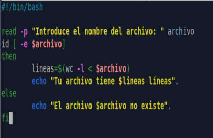
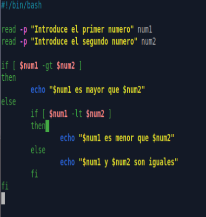
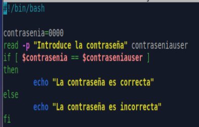
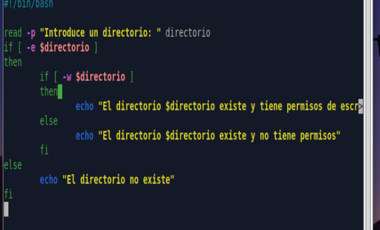

Ejercicio 1: Contar líneas de un archivo

Ejercicio 2: Verificación de archivo

Ejercicio 3: Comparación de dos números

Ejercicio 4: Validación de contraseña

Ejercicio 5: Comprobación de directorio

Ejercicio 6: Verificar si el usuario es root

Ejercicio 7: Calificación de un examen

Ejercicio 8: Comprobación del espacio en disco

Ejercicio 9: Menú de opciones

Ejercicio 10: Evaluación de edad
