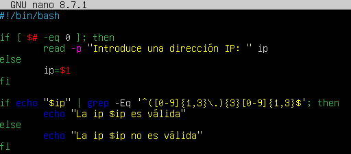
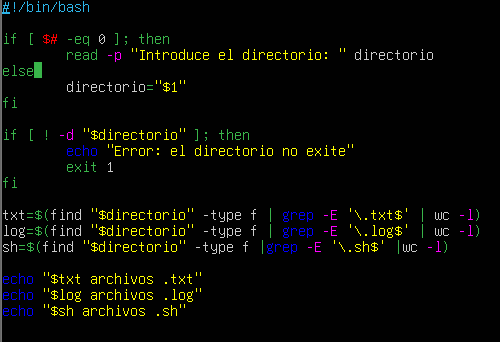
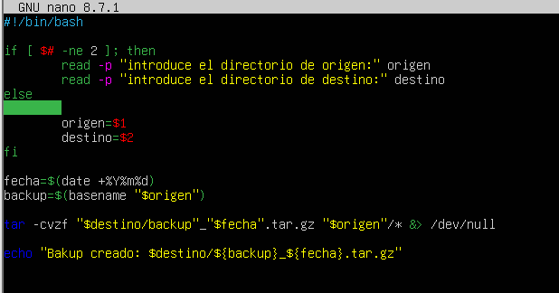

1. Calculadora básica
Crea un script que funcione como una calculadora de operaciones básicas.

2. Validador de direcciones IP
Crea un script que verifique si una dirección IP es válida.

3. Contador de archivos por tipo
Crea un script que cuente los archivos con extensión txt, log y sh que hay en dicho directorio.

4. Backup de un directorio
Crea un script que realice una copia de seguridad de un directorio.

5. Conversor de temperatura (Celsius ⇄ Fahrenheit)
Crea un script que convierta una temperatura entre Celsius y Fahrenheit.

[Volver al inicio](../index.md)
