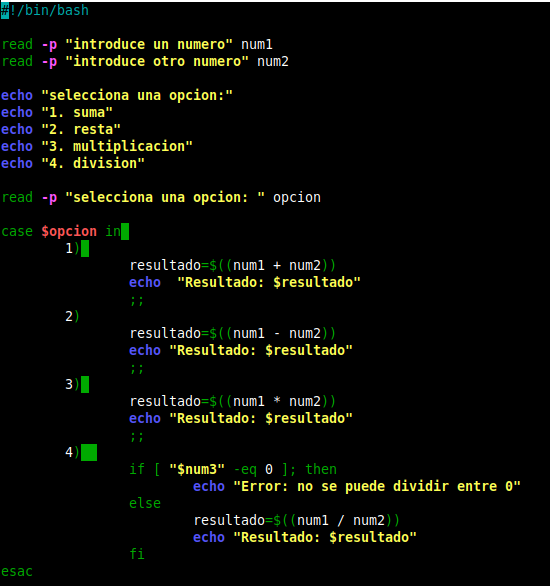
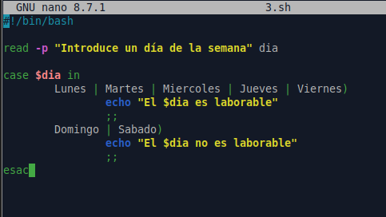
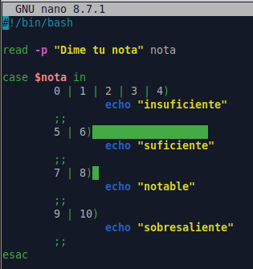
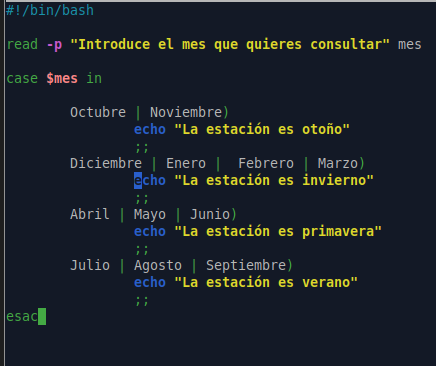
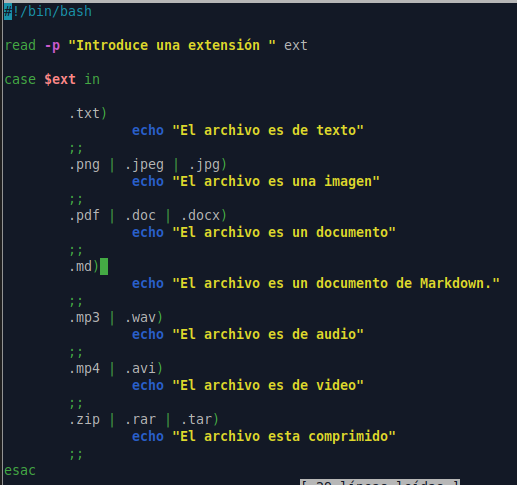
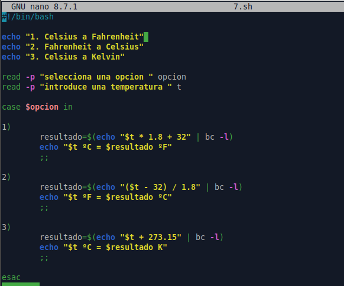
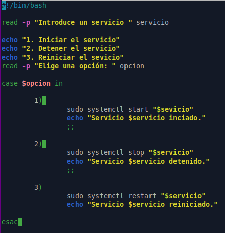
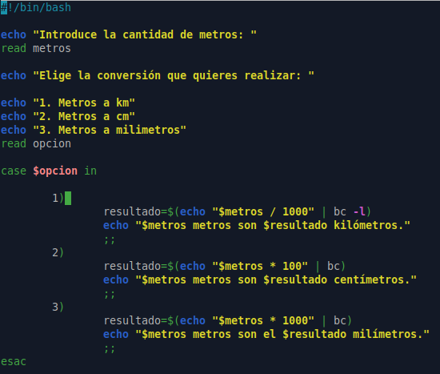

1. Calculadora básica.

2. Verificacion día de la semana.

3. Clasificar calificaciones.

4. Estaciones.

5. Identificar el tipo de archivo.

6. Convertir temperaturas.

7. Estado del servicio.

8. Conversor metros
